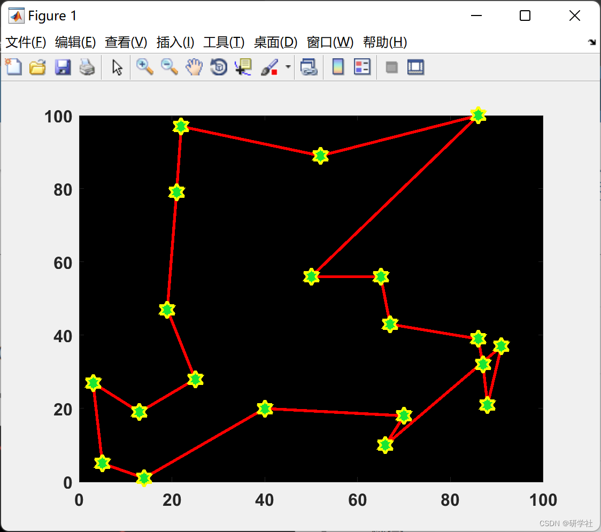
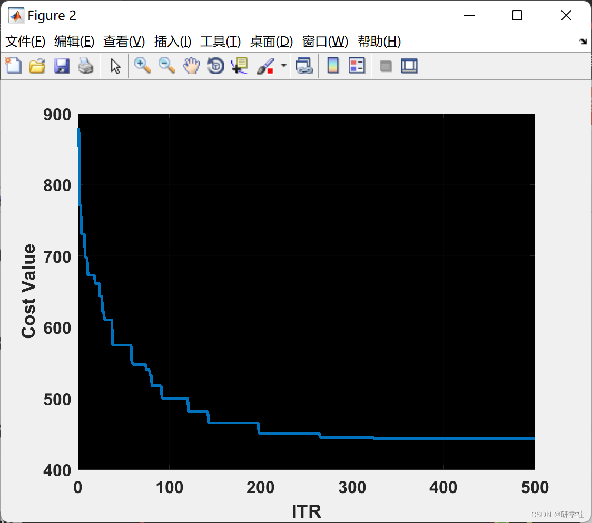

# Solution to TSP Problem Based on Teaching Optimization Algorithm (TLBO) (Matlab Code Implementation)

🏆 Bloggers' Advantage: 🌞🌞🌞 The content of the blog is as rigorous in thought and clear in logic as possible to facilitate readers.
⛳️ Mantra: A journey of a thousand miles begins with a single step. 📜 1 Overview📚 2 Run Results🎉 3 References🌈 4 MATLAB Code Implementation  
💥1 Overview TLBO, proposed by Rao et al. in 2011, is an algorithm-agnostic heuristic optimization method that does not require any specific algorithm parameters. This method simulates the traditional classroom teaching process. The entire optimization process includes two phases: teacher phase and learner phase. In the teacher phase, each student learns from the best individual among them. In the learning phase, each student learns from other students in a random manner.  
Based on Teaching Optimization (TLBO) is a group-based optimization method that simulates the classroom teaching process. TLBO consists of two parts. The first part is the "Teacher phase", where students learn from teachers; the second part is the "Learner phase", where students learn from each other through interactions. In TLBO, the population is considered as a class of learners. Each learner represents an alternative solution to the optimization problem, with scores representing fitness values. The teacher is considered to be the best solution obtained so far.  
This paper applies this relatively new algorithm to solve the classic problem of TSP, using MATLAB code for implementation.  
📚2 Run Results​ Edit  
Partial code:  
%% TLBO Parameters  
MaxIt = 500;    % Maximum Number of Iterations  
nPop = 50;     % Population Size  
%% Start  
% Empty Individuals  
empty_individual.Position = [];  
empty_individual.Cost = [];  
empty_individual.Sol = [];
% Population Array  
pop = repmat(empty_individual, nPop, 1);  
% Initialize Best Solution  
BestSol.Cost = inf;  
% Population Members  
for i = 1:nPop  
pop(i).Position = unifrnd(VarMin, VarMax, VarSize);  
[pop(i).Cost pop(i).Sol] = CostFunction(pop(i).Position);  
if pop(i).Cost < BestSol.Cost  
BestSol = pop(i);  
end  
end  
% Best Cost Record  
BestCosts = zeros(MaxIt, 1);  
%% TLBO  
for it = 1:MaxIt  
% Calculate Population Mean  
Mean = 0;  
for i = 1:nPop  
Mean = Mean + pop(i).Position;  
end  
Mean = Mean/nPop;  
% Select Teacher  
Teacher = pop(1);  
for i = 2:nPop  
if pop(i).Cost < Teacher.Cost  
Teacher = pop(i);  
end  
end  
% Teacher Phase  
for i = 1:nPop  
% Create Empty Solution  
newsol = empty_individual;  
% Teaching Factor  
TF = randi([1 2]);  
% Teaching (moving towards teacher)  
newsol.Position = pop(i).Position ...  
+ rand(VarSize).*(Teacher.Position - TF*Mean);  
% Clipping  
newsol.Position = max(newsol.Position, VarMin);  
newsol.Position = min(newsol.Position, VarMax);  
% Evaluation  
[newsol.Cost newsol.Sol] = CostFunction(newsol.Position);  
% Comparision  
if newsol.Cost<pop(i).Cost  
pop(i) = newsol;  
if pop(i).Cost < BestSol.Cost  
BestSol = pop(i);  
end  
end  
end  
% Learner Phase  
for i = 1:nPop  
A = 1:nPop;  
A(i) = [];  
j = A(randi(nPop-1));  
Step = pop(i).Position - pop(j).Position;  
if pop(j).Cost < pop(i).Cost  
Step = -Step;  
end  
% Create Empty Solution  
newsol = empty_individual;  
% Teaching (moving towards teacher)  
newsol.Position = pop(i).Position + rand(VarSize).*Step;  
% Clipping  
newsol.Position = max(newsol.Position, VarMin);  
newsol.Position = min(newsol.Position, VarMax);  
% Evaluation  
[newsol.Cost newsol.Sol] = CostFunction(newsol.Position);  
% Comparision  
if newsol.Cost<pop(i).Cost  
pop(i) = newsol;  
if pop(i).Cost < BestSol.Cost  
BestSol = pop(i);  
end  
end  
end  
BestCosts(it) = BestSol.Cost;  
% Iteration  
disp(['In ITR ' num2str(it) ': TLBO Cost Value Is = ' num2str(BestCosts(it))]);  
% Plot Res  
figure(1);  
Plotfig(BestSol.Sol.tour,model);  
end  
%% ITR  
figure;  
plot(BestCosts, 'LineWidth', 2);  
xlabel('ITR');  
ylabel('Cost Value');  
ax = gca;  
ax.FontSize = 12;  
ax.FontWeight='bold';  
set(gca,'Color','k')  
grid on;  
🎉3 References
🌈4 Matlab code implementation

## Images

<!-- PAYMENT_BLOCK -->

## Get this dataset

- Payment link (Stripe): [Buy now](https://buy.stripe.com/3cs8yP7sY87d0vu9AB)
- Payment QR code: 

<!-- /PAYMENT_BLOCK -->
